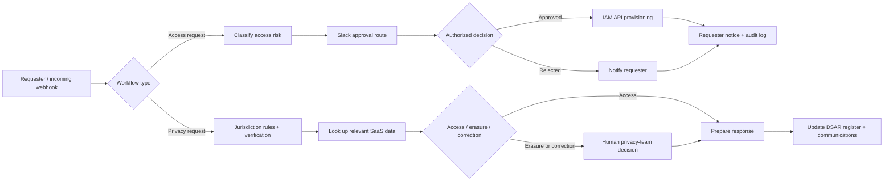

# n8n Shop


**Enterprise IT automation, built with controls—not just connectors.**

This repository contains importable n8n workflow examples for IAM approvals and privacy operations, maintained by [Andrew Yonan](https://linkedin.com/in/Andrew-Yonan). The workflows use synthetic or generic configurations: no employer credentials, internal tenant data, or proprietary APIs are required to read the source.

> **Scope:** Reference implementations for evaluation and adaptation. Review security, policy, external permissions, data retention, and service-specific endpoints before any production deployment.

## Workflows

| Workflow | Description | Folder |
|---|---|---|
| Privacy Requests (GDPR + CCPA) | Access, erasure and correction requests across Slack, Google Workspace and Jira under GDPR or California's CCPA: jurisdiction rules table, identity check, deadline tracking, DPO approval gate, register | [`/workflows/gdpr-dsar`](workflows/gdpr-dsar) |
| Access Request & Approval | Human-in-the-loop IAM access approval with risk-based routing and audit logging | [`/workflows/access-request-approval`](workflows/access-request-approval) |

*Explore each workflow's README for its exact setup, credential requirements, and limitations.*

## Architecture at a glance



**Two distinct patterns:** risk-based IAM access approval and privacy-request orchestration. The diagrams represent the exported workflow design; you must attach your own integrations, approvals, and organizational policy.

## Quick start

1. Choose [Access Request & Approval](workflows/access-request-approval/README.md) or [Privacy Request (GDPR / CCPA)](workflows/gdpr-dsar/README.md).
2. Open the relevant folder, download the workflow JSON, and import it via **n8n → Workflows → Import from File**.
3. Configure the credentials, integration URLs, approval channels, and settings documented in that workflow's README.
4. Test only with synthetic identities and nonproduction applications. Review the expected branches before enabling destructive or privileged actions.
5. Activate the workflow only after your team's security and change-control review.

### Validate the exported workflows

Run from the repository root with Python and Node.js installed:

```bash
python scripts/validate_workflows.py
node --test tests/*.test.js
```

These checks validate exported workflow structure and code-node logic; **they do not prove a live end-to-end integration** with your Slack, IAM, or privacy systems.

## Visual documentation

The architecture above renders directly on GitHub. To document a live demo, capture a **sanitized n8n canvas** and a **redacted test execution** after importing the workflows. Never publish access tokens, webhook/resume URLs, employee identifiers, internal workspace names, or real DSAR records. No runtime screenshots are included yet.

## Why this exists

Most workflow examples online are toy demos. These are built the way real enterprise IT/IAM automation actually needs to work: with approval gates, error handling, retries, and audit trails — not just "connect A to B."

## Quality checks

Every push runs [`validate-workflows`](.github/workflows/validate.yml):

- `scripts/validate_workflows.py` checks that each workflow is valid JSON, every connection points at a real node, every node is reachable from a trigger, Code nodes are valid JavaScript, and no secrets are hardcoded.
- `tests/` unit-tests the JavaScript inside Code nodes, read straight from the workflow files.

All workflows also import cleanly into n8n 2.46.7, and every node parameter checks out against n8n's own node definitions.

```bash
python scripts/validate_workflows.py
node --test tests/*.test.js
```

## License

MIT — use, modify, and share freely. Attribution appreciated but not required.

## Connect

Built by an IT/IAM engineer navigating enterprise automation, identity, and SaaS governance daily. Feedback and workflow requests welcome via Issues.
