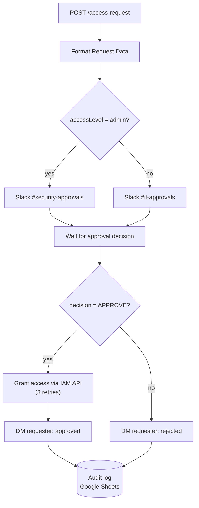

# Access Request & Approval (n8n)

Human-in-the-loop access approval for SaaS apps, with risk-based routing, automated provisioning, requester notifications, and an audit trail.

## Flow



## Request payload

```json
POST https://<your-n8n>/webhook/access-request
{
  "requesterName": "Jane Doe",
  "requesterEmail": "jane.doe@example.com",
  "requesterSlackId": "U0123456789",
  "appRequested": "Salesforce",
  "accessLevel": "standard",
  "justification": "Need read access for Q3 pipeline review",
  "requestedAt": "2026-11-06T17:00:00Z"
}
```

`accessLevel: "admin"` routes to the security lead; anything else goes to the standard IT approver.

## Approval decision

The approver's action (a Slack button, form, or ticket automation) calls the Wait node's resume URL with:

```json
{ "decision": "APPROVE" }
```

Any other value is treated as a rejection.

## Setup

| Item | Where |
|---|---|
| Slack credential (`chat:write`) | n8n Credentials → Slack |
| Channels `#security-approvals`, `#it-approvals` | Your workspace (or edit the Slack nodes) |
| `IAM_API_BASE_URL` | n8n environment variable; your provisioning API (Okta, Entra ID, internal) |
| IAM API auth | n8n Credentials → Header Auth |
| `AUDIT_LOG_SHEET_ID` | n8n environment variable; sheet needs an `AccessLog` tab |
| Google Sheets credential | n8n Credentials → Google Sheets |

## Design notes

- **Risk-based routing:** admin requests go to security; standard requests go to IT.
- **Reliable provisioning:** the IAM call retries up to 3 times before failing.
- **Data after the wait step:** nodes after the Wait read the original request via `$('Format Request Data')`, because `$json` at that point holds the approval callback.
- **Auditability:** every request is appended to a Google Sheet for access reviews (SOX/SOC 2 evidence).
