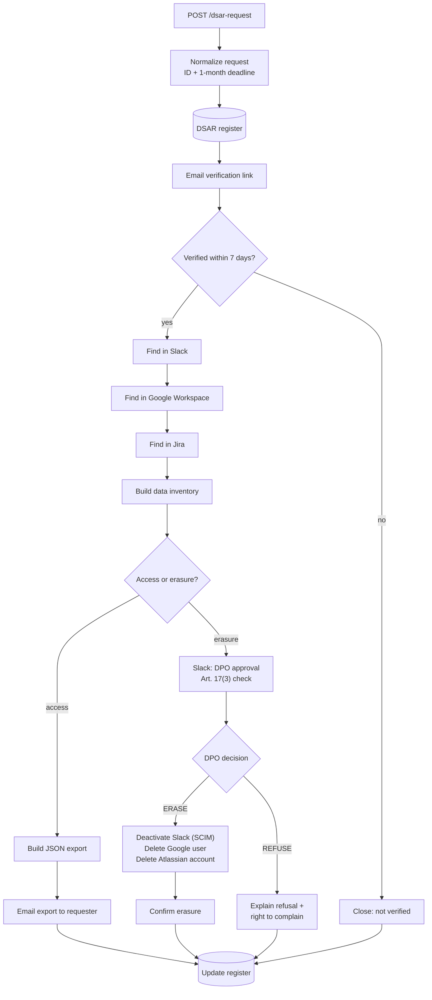

# GDPR Data Subject Request (DSAR) Automation


Handles GDPR access (Art. 15) and erasure (Art. 17) requests across workplace SaaS tools, from intake to closure. Every request is identity-checked, tracked against its legal deadline, gated by a DPO decision before anything is deleted, and logged in a register for accountability.

## Why this matters

Every organisation in the EU must answer data subject requests within one month. In most IT teams that means someone searching Slack, Google Workspace and Jira by hand, tracking deadlines in their head, and hoping nothing was missed. This workflow makes the process repeatable, auditable and on time.

## Flow



A second workflow, **Deadline Monitor**, reads the register every morning at 08:00 (Europe/Berlin) and alerts `#privacy-team` in Slack about any open request that is overdue or due within 7 days.

## Compliance mapping

| GDPR requirement | How the workflow handles it |
|---|---|
| Art. 12(3): respond within one month | `Normalize Request` sets the deadline to one calendar month from receipt (31 Jan → 28 Feb). The Deadline Monitor flags requests from 7 days out. |
| Art. 12(4): explain a refusal and the right to complain | `Explain Refusal to Requester` sends the DPO's reason and points to the supervisory authority. |
| Art. 12(6): confirm the requester's identity | A verification link is emailed to the address on record. Nothing is searched or sent until it is clicked. |
| Art. 15: right of access | Data found in each system is compiled into a JSON export and emailed to the requester. |
| Art. 17: right to erasure | Accounts are deactivated or deleted in Slack, Google Workspace and Atlassian. |
| Art. 17(3): exceptions to erasure | No deletion runs without a DPO decision. The approval message lists the retention checks to make first. |
| Art. 5(1)(c) and (e): data minimisation and storage limitation | `saveDataSuccessExecution: none` keeps personal data from successful runs out of n8n's execution history. Prune failed executions too (`EXECUTIONS_DATA_PRUNE`). |
| Art. 5(2): accountability | Every request and its outcome is recorded in the DSAR register. |

> This is a technical template, not legal advice. Adapt the retention rules, wording and scope with your DPO.

## Request payload

```json
POST https://<your-n8n>/webhook/dsar-request
{
  "requestType": "access",
  "email": "max.mustermann@example.de",
  "fullName": "Max Mustermann",
  "receivedAt": "2026-11-06T09:30:00+01:00"
}
```

`requestType` is `access` or `erasure`. `receivedAt` is optional and defaults to now. Set it when a request arrives by post or email and is logged later, because the deadline runs from receipt.

## DPO decision

The approval message in `#privacy-approvals` contains the Wait node's resume URL. Post one of these to it:

```json
{ "decision": "ERASE" }
{ "decision": "REFUSE", "reason": "Employment records must be retained for 6 years under national law." }
```

## DSAR register

Create a Google Sheet with a tab named `DSARRegister` and these columns:

| RequestId | RequestType | Email | ReceivedAt | Deadline | Status | SystemsFound | CompletedAt |
|---|---|---|---|---|---|---|---|

Status moves from `Received - awaiting verification` to one of `Completed - access fulfilled`, `Completed - erased`, `Completed - refused` or `Closed - not verified`.

## Setup

| Item | Where |
|---|---|
| `DSAR_REGISTER_SHEET_ID`, `DSAR_FROM_EMAIL`, `JIRA_BASE_URL` | n8n environment variables |
| SMTP credential | n8n Credentials → SMTP (used by the email nodes) |
| Slack credential (`users:read.email`, `chat:write`) | n8n Credentials → Slack API |
| Slack SCIM token (Enterprise Grid / Business+) | n8n Credentials → Header Auth (`Authorization: Bearer …`) |
| Google Workspace admin (Directory API, `admin.directory.user`) | n8n Credentials → Google OAuth2 API |
| Jira Cloud | n8n Credentials → Jira Software Cloud API |
| Atlassian org admin API key | n8n Credentials → Header Auth |
| Slack channels `#privacy-approvals`, `#privacy-team` | Your workspace, or edit the Slack nodes |

Import `dsar-workflow.json` and `deadline-monitor.json` through **Workflows → Import from File**, attach your credentials, and activate both.

## Design notes

- **Lookups never fail the run.** Each "Find in …" node continues on error, because "not found" is a valid answer. `Build Data Inventory` records which systems hold the person.
- **Erasure order matters.** Slack is deactivated first (SCIM), then the Google account is deleted. Run a Google Drive data transfer before approving if files must be kept.
- **Tested logic.** The JavaScript in the Code nodes (deadline calculation, inventory, deadline alerts) is unit-tested straight from the workflow JSON in [`tests/`](../../tests), and CI validates every workflow on push.

## Roadmap

- Notify downstream recipients of erasure (Art. 19)
- Support the two-month extension for complex requests, with an automatic notice to the requester
- More connectors: Microsoft 365 / Entra ID, Zoom, Kaltura
