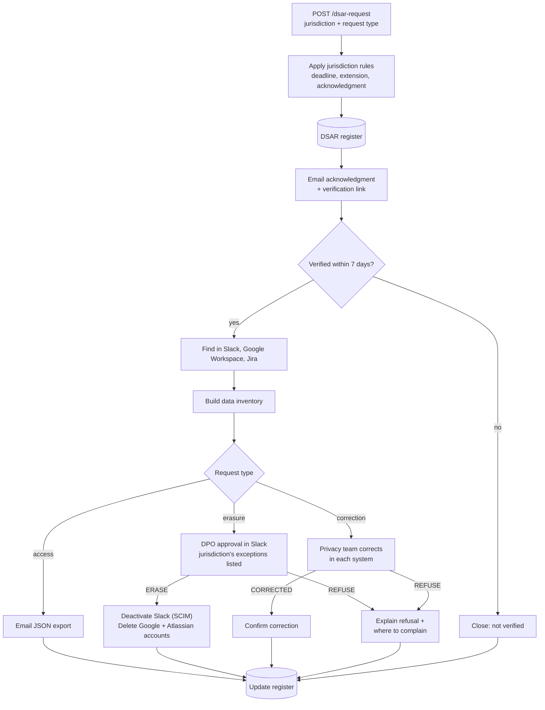

# Privacy Request (DSAR) Automation: GDPR and CCPA


Handles **access**, **erasure** and **correction** requests across workplace SaaS tools, under **GDPR** (EU/EEA) or **CCPA/CPRA** (California). Every request is acknowledged, identity-checked, tracked against its legal deadline, gated by a human decision before anything is deleted or changed, and logged in a register.

One workflow serves both laws. The jurisdiction on each request selects a row in a rules table, which sets the deadlines, legal references, deletion exceptions and complaint wording. Adding another law is a new row, not a new workflow.

## Why this matters

Privacy laws give people the right to see, correct and delete the data an organisation holds about them, on a deadline. Since 1 January 2023, California's law has covered employee and job-applicant data too, so workplace tools are in scope on both sides of the Atlantic. In most IT teams, answering means searching Slack, Google Workspace and Jira by hand and tracking dates in a spreadsheet. This workflow makes the process repeatable, auditable and on time.

## Flow



A second workflow, **DSAR Deadline Monitor**, reads the register every morning and alerts `#privacy-team` in Slack about open requests, in any jurisdiction, that are overdue or due within 7 days.

## Jurisdiction rules

| | GDPR (EU/EEA) | CCPA/CPRA (California) |
|---|---|---|
| Deadline | One calendar month from receipt (Art. 12(3)) | 45 calendar days from receipt (Cal. Code Regs. tit. 11, § 7021(b)) |
| Extension | Up to two further months, with notice | Up to 45 more days (90 in total), with notice and the reason |
| Acknowledgment | No separate deadline | Within 10 business days (§ 7021(a)) |
| Clock starts | On receipt | On receipt, even while identity is still being verified |
| Access | Art. 15 | Right to know |
| Erasure exceptions shown to the DPO | Art. 17(3) | Cal. Civ. Code § 1798.105(d) |
| Correction | Art. 16 | Right to correct |
| Refusal email points to | A supervisory authority and judicial remedy (Art. 12(4)) | The California Privacy Protection Agency |

Examples the tests check: GDPR 31 Jan → 28 Feb (extendable to 30 Apr). CCPA received Friday 6 Nov 2026 → acknowledge by 20 Nov, respond by 21 Dec, 4 Feb 2027 at most.

## Compliance mapping

| Requirement | How the workflow handles it |
|---|---|
| Respond on time (GDPR Art. 12(3); CCPA § 7021(b)) | `Normalize Request` computes the deadline and the latest extended date from the jurisdiction's rules. The Deadline Monitor flags requests from 7 days out. |
| Acknowledge receipt (CCPA § 7021(a)) | The first email goes out immediately. It confirms receipt, states the deadline and explains verification, well inside 10 business days. |
| Confirm the requester's identity (GDPR Art. 12(6); CCPA verification) | A verification link is emailed to the address on record. Nothing is searched until it is clicked. |
| Access / right to know | Data found in each system is compiled into a JSON export and emailed. |
| Erasure / right to delete | Accounts are deactivated or deleted in Slack, Google Workspace and Atlassian, but only after a DPO decision. |
| Exceptions to deletion (GDPR Art. 17(3); CCPA § 1798.105(d)) | The approval message lists the exceptions for the request's jurisdiction. |
| Correction (GDPR Art. 16; CCPA right to correct) | The privacy team makes the change, then confirms with a summary that is emailed to the requester. |
| Explain refusals (GDPR Art. 12(4)) | `Explain Refusal to Requester` sends the reason and the jurisdiction's complaint route. |
| Data minimisation (GDPR Art. 5(1)(c), (e)) | `saveDataSuccessExecution: none` keeps personal data from successful runs out of n8n's execution history. Prune failed executions too (`EXECUTIONS_DATA_PRUNE`). |
| Accountability and records | Every request, its acknowledgment time and its outcome are recorded in the DSAR register. |

> This is a technical template, not legal advice. Review the rules, wording and scope with your DPO or counsel.

## Request payload

```json
POST https://<your-n8n>/webhook/dsar-request
{
  "jurisdiction": "CCPA",
  "requestType": "know",
  "email": "jane.doe@example.com",
  "fullName": "Jane Doe",
  "receivedAt": "2026-11-06T09:30:00-08:00"
}
```

| Field | Values |
|---|---|
| `jurisdiction` | `GDPR` (default) or `CCPA` |
| `requestType` | `access` / `know`, `erasure` / `delete`, `correction` / `correct` / `rectification` |
| `details` | Required for corrections: what is wrong and what it should say |
| `receivedAt` | Optional, defaults to now. Set it when a request arrived by post or email and is logged later, because the clock runs from receipt. |

## Decisions

Approval messages in `#privacy-approvals` contain the Wait node's resume URL. Post one of these to it.

Erasure:

```json
{ "decision": "ERASE" }
{ "decision": "REFUSE", "reason": "Payroll records must be retained under tax law." }
```

Correction:

```json
{ "decision": "CORRECTED", "summary": "Job title updated in Google Workspace and Slack profile." }
{ "decision": "REFUSE", "reason": "The record is accurate; we have noted your disagreement." }
```

## DSAR register

Create a Google Sheet with a tab named `DSARRegister` and these columns:

| RequestId | Jurisdiction | RequestType | Email | ReceivedAt | AcknowledgedAt | Deadline | Status | SystemsFound | CompletedAt |
|---|---|---|---|---|---|---|---|---|---|

Status moves from `Received - awaiting verification` to one of `Completed - access fulfilled`, `Completed - erased`, `Completed - corrected`, `Completed - refused` or `Closed - not verified`.

## Setup

| Item | Where |
|---|---|
| Register sheet ID, sender address, Jira URL | The **Workflow Configuration** node at the start of each workflow |
| SMTP credential | n8n Credentials → SMTP (used by the email nodes) |
| Slack credential (`users:read.email`, `chat:write`) | n8n Credentials → Slack API |
| Slack SCIM token (Enterprise Grid / Business+) | n8n Credentials → Header Auth (`Authorization: Bearer …`) |
| Google Workspace admin (Directory API, `admin.directory.user`) | n8n Credentials → Google OAuth2 API |
| Jira Cloud | n8n Credentials → Jira Software Cloud API |
| Atlassian org admin API key | n8n Credentials → Header Auth |
| Slack channels `#privacy-approvals`, `#privacy-team` | Your workspace, or edit the Slack nodes |

Import `dsar-workflow.json` and `deadline-monitor.json` through **Workflows → Import from File**, attach your credentials, and activate both. Sticky notes on the canvas walk through each section and the setup.

## Adding a jurisdiction

Add an entry to `RULES` at the top of the **Normalize Request** Code node:

```js
VCDPA: {
  name: 'VCDPA (Virginia)',
  deadline: { days: 45 },
  extension: { days: 45 },
  acknowledgeWithin: null,
  refs: { access: '...', erasure: '...', correction: '...' },
  erasureExceptions: '...',
  complaint: '...',
},
```

Periods can be `months`, `days` or `businessDays`. Then add a test case in `tests/code-nodes.test.js`.

## Design notes

- **One workflow, a rules table per law.** The process (verify, locate, act, record) is the same everywhere. Only the clocks and wording differ, so they live in data, not in duplicated nodes.
- **Lookups never fail the run.** Each "Find in …" node continues on error, because "not found" is a valid answer. `Build Data Inventory` records which systems hold the person.
- **Humans make the irreversible calls.** Erasure and correction both wait for a person's decision. Run a Google Drive data transfer before approving an erasure if files must be kept.
- **Business days skip weekends but not public holidays**, so the acknowledgment date is conservative. Because the acknowledgment email goes out immediately, this only matters if you change that.
- **Tested logic.** Deadline, acknowledgment and extension dates for both jurisdictions, request-type aliases, the inventory and the deadline alerts are unit-tested straight from the workflow JSON in [`tests/`](../../tests). CI validates every workflow on push. The rules code has also been run inside n8n 2.46.7 against GDPR and CCPA sample requests.

## Roadmap

- Notify downstream recipients of erasure or correction (GDPR Art. 19; CCPA service providers)
- Send the extension notice to the requester automatically when the team marks a request as complex
- More jurisdictions (Virginia, Colorado, UK GDPR) and more connectors (Microsoft 365 / Entra ID, Zoom, an HRIS)
